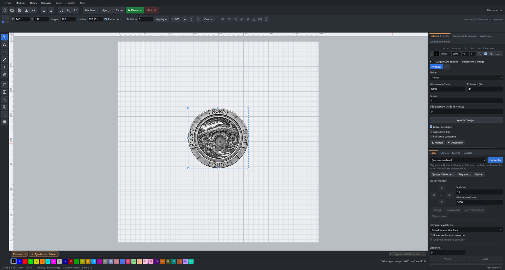
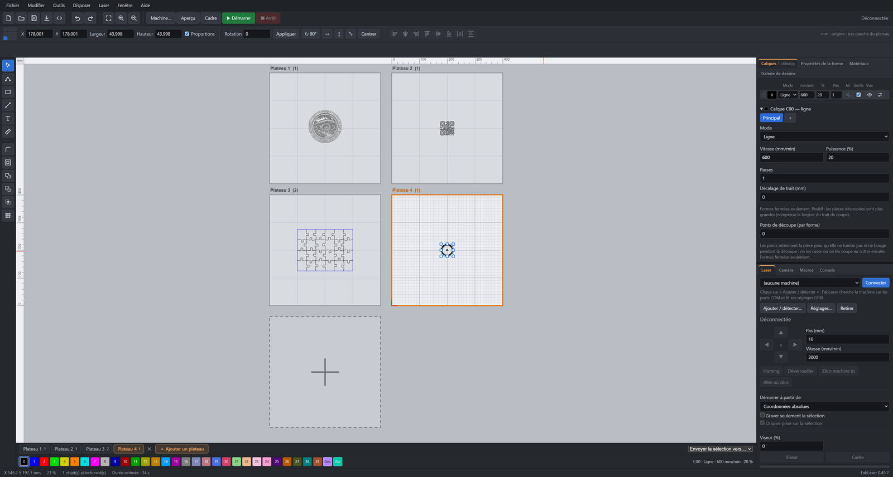
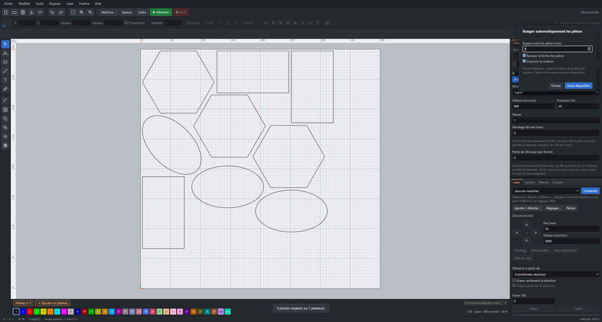
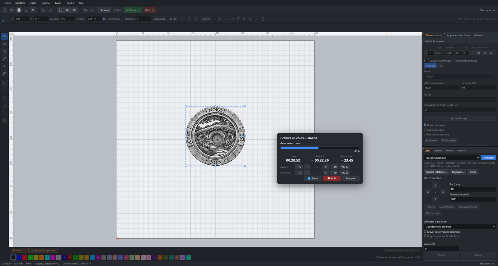

# FabLaser

**English: [read the README in English](README.md)**

Logiciel de gravure et de découpe laser pour machines GRBL (diodes), sous Windows. Développé par [Egalistel](https://egamaker.be).

> **Bêta fermée.** FabLaser est en test auprès d'un petit nombre de personnes. Une clé est nécessaire pour l'utiliser. Pour en demander une, rendez-vous sur la [page de la bêta](https://egamaker.be/fablaser-beta/).

## Ce que fait FabLaser

- Dessin vectoriel : formes, texte, nœuds, union, soustraction, intersection, décalage, réseau, alignement.
- Import SVG, DXF et images, avec réparation des tracés.
- Réglages par calque : remplissage, ligne, image, perforation, entrée de découpe.
- Plusieurs plateaux dans un même projet, avec gravure en séquence.
- Rangement automatique des pièces, en suivant leur forme réelle.
- Reprise d'une gravure interrompue, macros, caméra, timelapse, intégration Home Assistant.
- Interface en français et en anglais, quatre thèmes.

## Télécharger

Les installateurs sont dans l'onglet [Releases](../../releases). FabLaser vérifie lui-même les mises à jour.

## Retours et idées

Les idées et les problèmes se signalent directement depuis le logiciel (menu Aide), ou sur [egamaker.be](https://egamaker.be/fablaser-beta/).

## Soutenir le projet

FabLaser est gratuit. Si le logiciel vous est utile, vous pouvez soutenir son développement : [Buy Me a Coffee](https://buymeacoffee.com/egalistelW).
