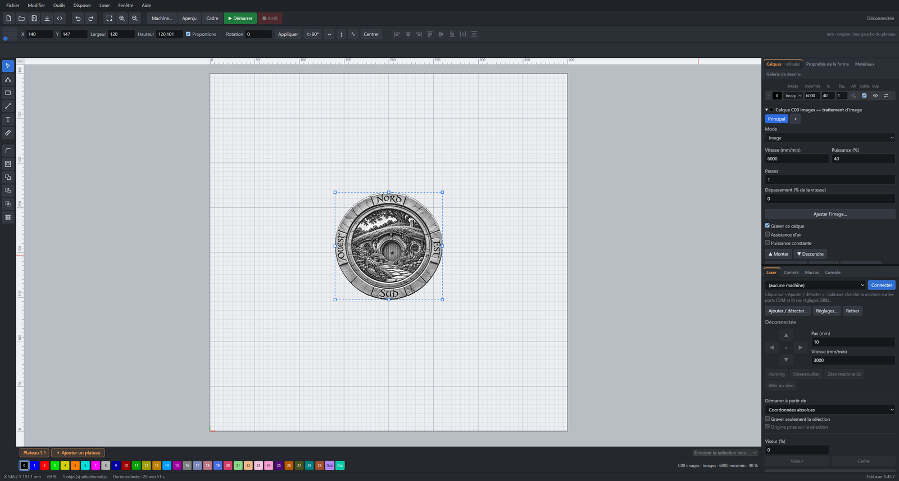
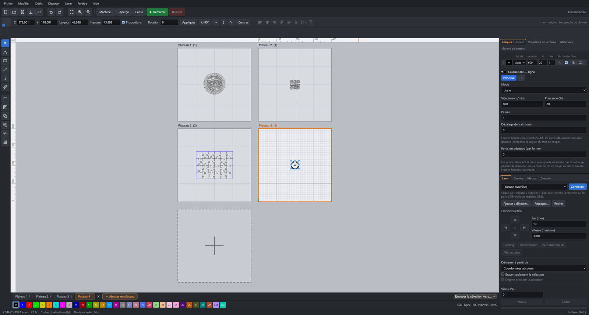
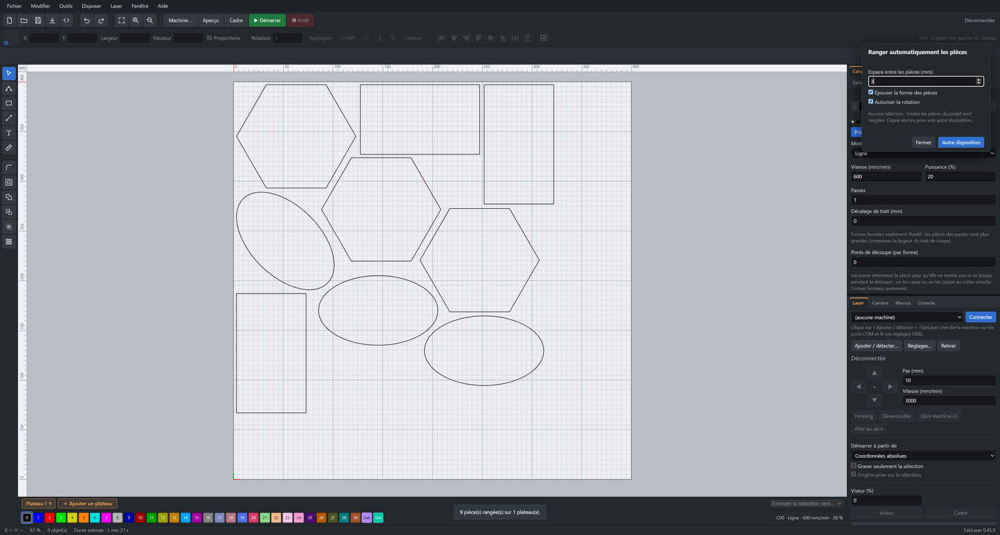
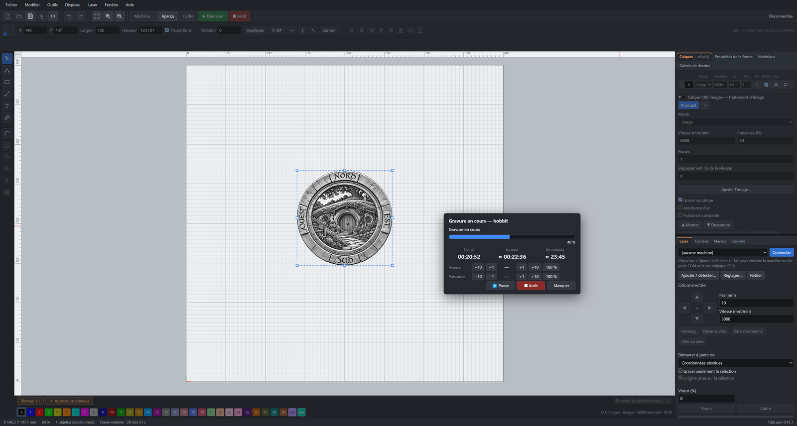
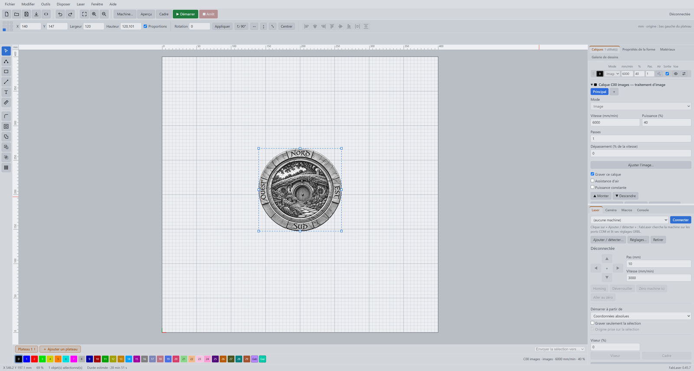

# FabLaser

Laser engraving and cutting software for GRBL machines (diode lasers), for Windows. Developed by [Egalistel](https://egamaker.be).

**Français : [lire le README en français](README.fr.md)**

> **Closed beta.** FabLaser is currently being tested by a small group of people and a key is required to use it. To ask for one, visit the [beta page](https://egamaker.be/fablaser-beta/) (in French).

## What FabLaser does

- Vector drawing: shapes, text, nodes, union, subtraction, intersection, offset, arrays, alignment.
- SVG, DXF and image import, with path repair.
- Per-layer settings: fill, line, image, perforation, cut lead-in.
- Several plates in one project, engraved in sequence.
- Automatic nesting of parts that follows their real shape.
- Resume an interrupted job, macros, camera, timelapse, Home Assistant integration.
- Interface in French and English, four themes.

## Download

Installers are in the [Releases](../../releases) tab. FabLaser checks for updates by itself.

## Feedback and ideas

Ideas and problems can be reported from inside the software (Help menu) or on [egamaker.be](https://egamaker.be/fablaser-beta/).

## Support the project

FabLaser is free to try. If it is useful to you, you can support its development: [Buy Me a Coffee](https://buymeacoffee.com/egalistelW).
